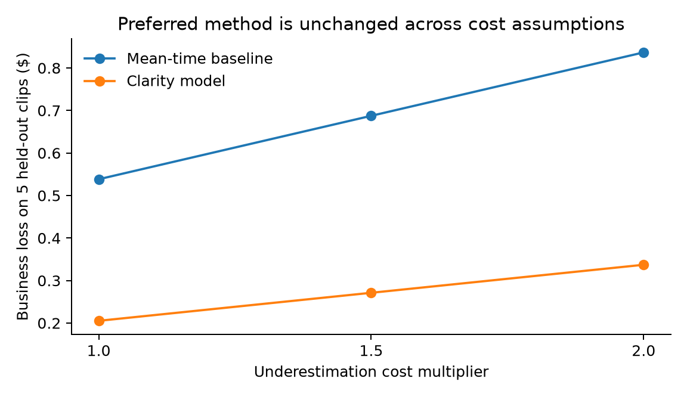

## Action

### Use clarity-adjusted estimates for clip-level staffing

Instead of assigning the same **70.4 s** to every clip, estimate review time from clarity:

\[
\widehat{\text{seconds}}=40.45+16.64(\text{clarity score})
\]

Under our base business scenario (**$30/hour; underestimation costs 1.5× overestimation**), schedule about **2.1 s above** the model point estimate:

| Clarity | Planning time |
|---|---:|
| Clear | **59 s** |
| Moderately unclear | **76 s** |
| Very unclear | **92 s** |

Use this rule only for footage similar to the data collected here.

## Reason

### The model was more useful on held-out clips

- Mean-time baseline MAE: **12.92 s**
- Clarity-model MAE: **4.93 s**
- Prediction error fell by about **62%**
- Base business loss on 5 held-out clips: **$0.688 → $0.271** (**61% lower**)

{width=62%}

The clarity model stayed preferred for **$20–$45/hour** and underestimation penalties from **1× to 2×**.

## Risk

### The evidence is promising, but narrow

**Largest held-out underestimation:** **9.3 s**

At the base assumptions, that miss is about **$0.12 of weighted decision loss for one clip**.

All 5 held-out clips fell inside the model's approximate 90% prediction intervals, but:

- only **20 clips** total and **5 held out**
- one reviewer, one evening, one scene type
- only **2 very-unclear clips**
- clarity was rated **after timing**, not blindly before it

**Do not generalize this model to new reviewers or new footage types yet.**

## Value

### Better clip estimates have measurable planning value

At the base assumptions, the model reduced business loss by:

\[
\$0.416 \text{ across 5 held-out clips}
=\mathbf{\$0.083/clip}
\]

If the same advantage generalized to **1,000 similar clips**, that would be about:

\[
\mathbf{\$83}
\]

less estimation loss.

That is a **scenario extrapolation, not a demonstrated saving**.  
The next valuable investment is **blind clarity ratings + more clips + more reviewers**.
